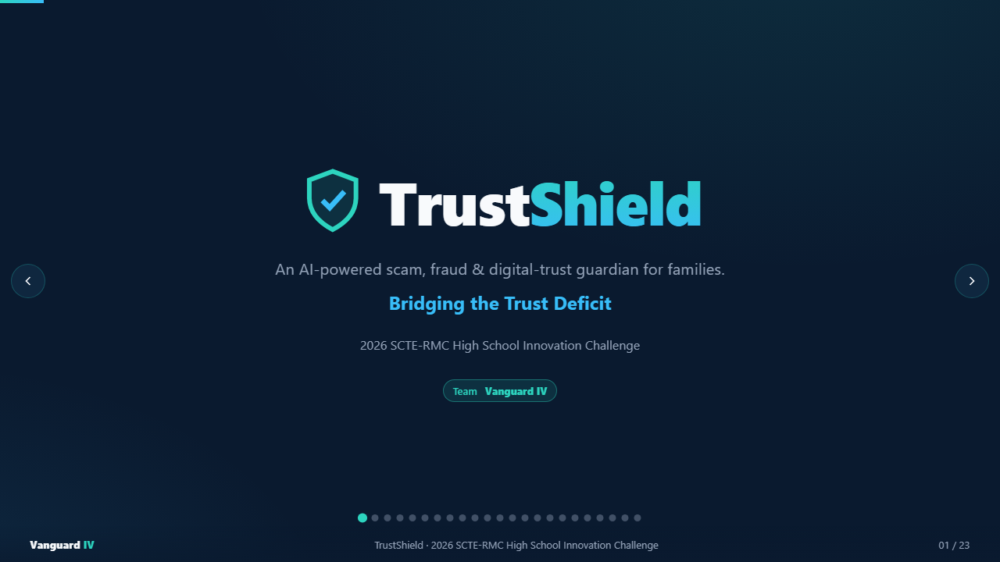
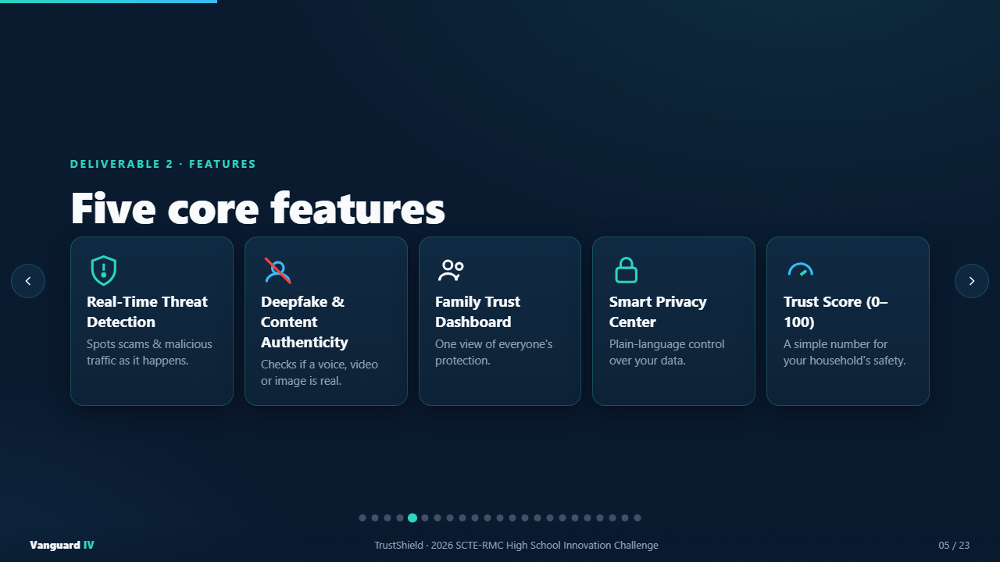
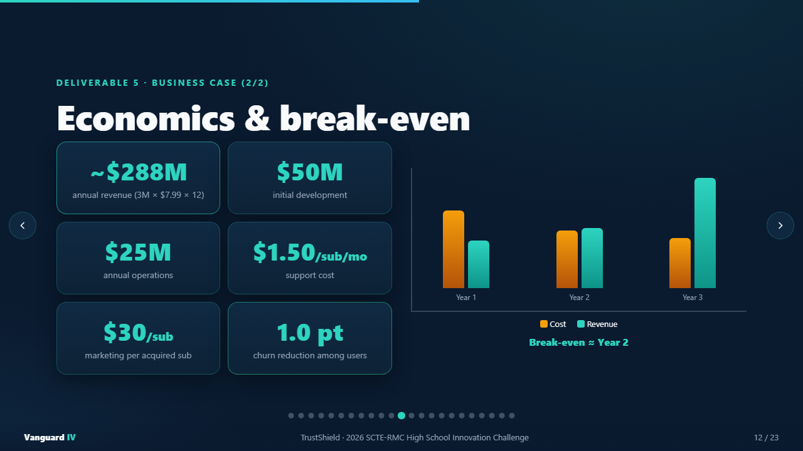
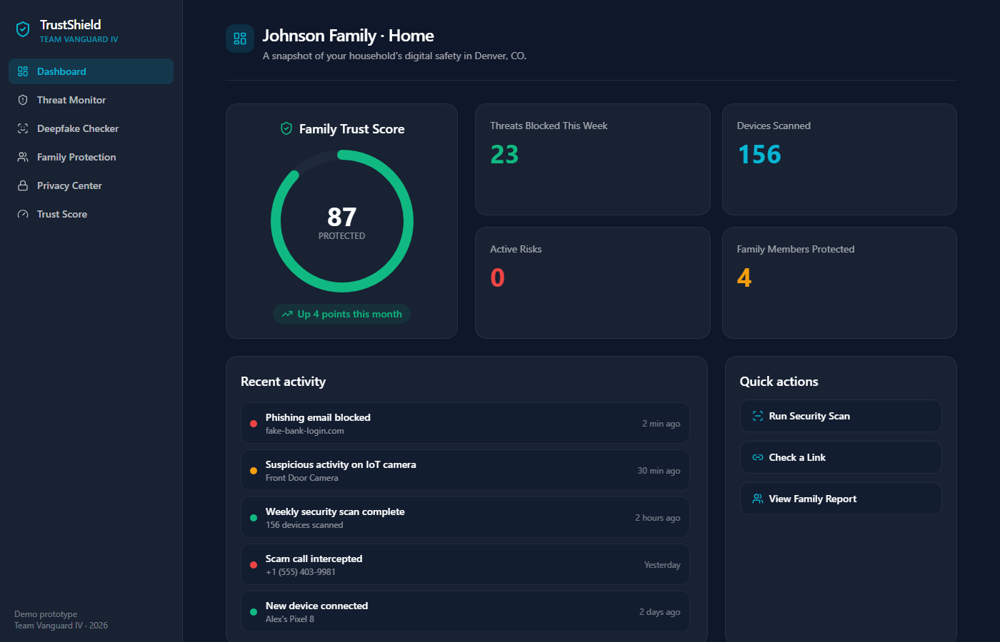
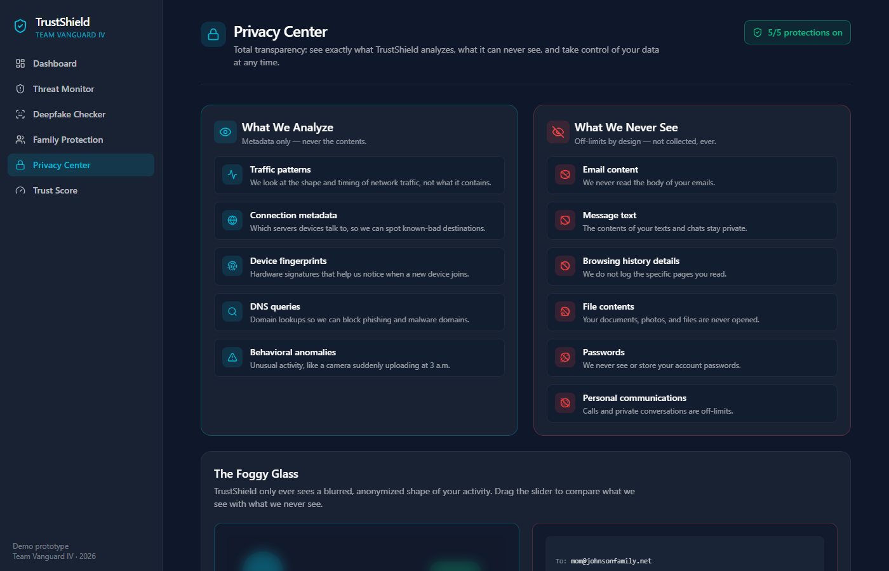
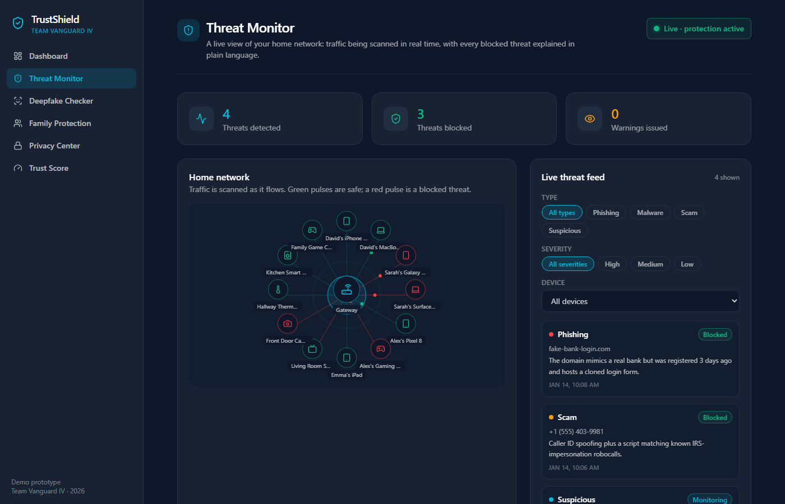
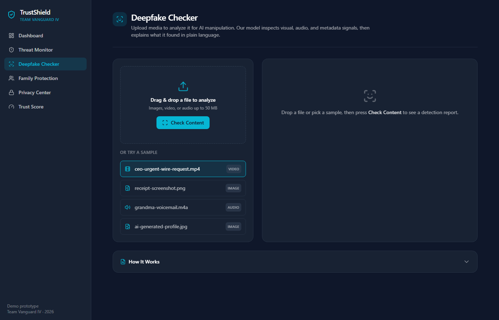
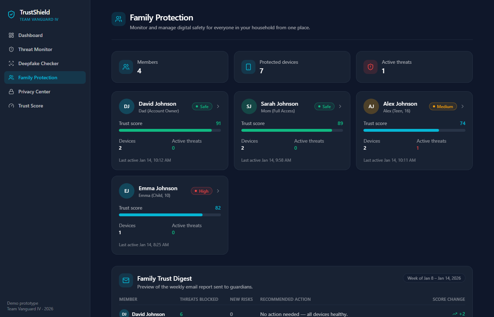
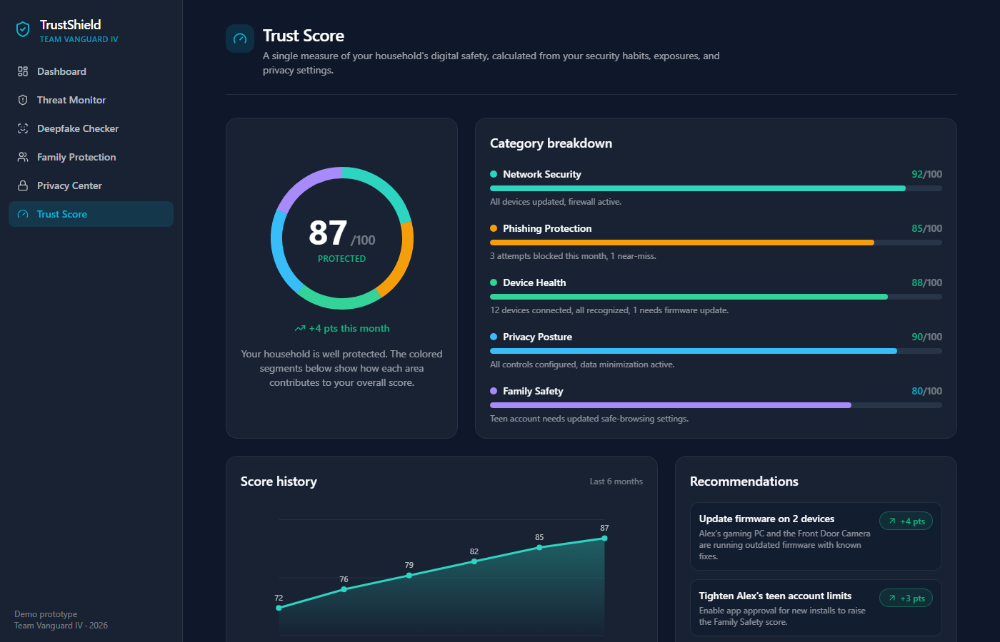

# 🛡️ Vanguard V — TrustShield

**2026 SCTE-RMC High School Innovation Challenge**
*Bridging the Trust Deficit: Designing Technologies That Restore Confidence in a Connected World*

---

## 👋 Welcome, Vanguard V!

This is your starting point for the Innovation Challenge. Inside this repo you'll find two things your team built:

1. **A working web app prototype** — a clickable demo of TrustShield with 6 interactive screens
2. **A presentation** — a 23-slide HTML deck covering all 10 required deliverables

Both are meant as a **foundation for you to build on**. Make them your own — change things, add ideas, break stuff and fix it. That's how you learn.

---

## 🖥️ What TrustShield Is

**TrustShield** is a concept for an AI-powered scam, fraud, and digital-trust guardian for families. It would be delivered through a broadband provider (like Spectrum, Comcast, etc.) using the Wi-Fi gateway that's already in your home.

Instead of making people juggle five different security apps, TrustShield combines threat detection, deepfake checking, family protection, and privacy controls into one dashboard — and sums it all up as a single **Trust Score**.

### The "Foggy Glass" Privacy Model
This is the key idea that makes TrustShield different: it analyzes network *patterns and shapes* — **never your actual content**. Think of looking through a frosted bathroom window — you can see if someone is there, but you can't read what's on their phone. That's how TrustShield works.

---

## 📸 What It Looks Like

### The Presentation
Open `presentation.html` in any browser. Use arrow keys or click to navigate.







### The Prototype App
A real interactive web app with 6 screens.













---

## 🚀 How to Run Everything

### The Presentation (Easy — No Install Needed)

1. Find the file `presentation.html` in this repo
2. Double-click it (or right-click → Open With → Chrome/Edge)
3. Use **arrow keys** (← →) or **click** the left/right edges to move between slides
4. That's it!

To edit the presentation, just open `presentation.html` in VS Code (or Notepad) and change the text you see. It's all in one file.

### The Prototype App (Using VS Code on Your PC)

This requires a few free tools installed first. Follow these steps carefully:

#### Step 1: Install Visual Studio Code (VS Code)
1. Go to [https://code.visualstudio.com](https://code.visualstudio.com)
2. Download and install VS Code for Windows (use all default settings)

#### Step 2: Install Node.js
1. Go to [https://nodejs.org](https://nodejs.org)
2. Download the **LTS** version (the big green button)
3. Run the installer — just click Next through everything, use all the defaults
4. When it's done, **restart your computer** (this makes sure the commands work)

#### Step 3: Install Git (if you don't have it)
1. Go to [https://git-scm.com/downloads](https://git-scm.com/downloads)
2. Download and install for your OS
3. Use all the default settings

#### Step 4: Download the Code & Open in VS Code
1. Open **VS Code**
2. Open the built-in Terminal inside VS Code by pressing **`Ctrl + ~`** (or from the top menu: **Terminal → New Terminal**)
3. In the terminal at the bottom of VS Code, type:
```bash
git clone https://github.com/cbytes1/VanguardV.git
cd VanguardV/trustshield-prototype
```
4. Then click **File → Open Folder...** in VS Code and select the `VanguardV` folder you just downloaded so you can see all the files in the left sidebar!

#### Step 5: Install Dependencies and Run
In the VS Code terminal (inside the `trustshield-prototype` folder), run:
```bash
npm install
npm run dev
```
*(Note: If Windows says `permission denied 0.0.0.0:3000` or `EACCES`, port 3000 is reserved by Windows. Just run `npx next dev -p 4000` instead and open `http://localhost:4000`!)*

#### Step 6: Open It in Your Browser
Open Chrome or Edge and go to: **http://localhost:3000** (or **http://localhost:4000** if you used port 4000).

You should see the TrustShield landing page. Click **"Start the tour"** or use the sidebar to explore all 6 screens.

> **⚡ Live Reloading (No Recompiling Needed!):** Keep the VS Code terminal running while you work. Every time you edit a file in VS Code and press **`Ctrl + S`** (Save), your browser tab updates **automatically on the fly** in about 1 second! To stop the server when you're done, click in the terminal and press `Ctrl + C`.

### The 6 Screens
| Screen | URL | What It Shows |
|---|---|---|
| Landing Page | `/` | Welcome page with overview |
| Dashboard | `/dashboard` | Trust Score, threat stats, recent activity |
| Threat Monitor | `/threat-monitor` | Live network map with threat detection |
| Deepfake Checker | `/deepfake-checker` | Check if content is AI-generated |
| Family Protection | `/family-protection` | Per-family-member controls and alerts |
| Privacy Center | `/privacy-center` | The "foggy glass" model + data controls |
| Trust Score | `/trust-score` | Score breakdown, history, recommendations |

---

## ✏️ How to Edit and Customize

### Editing the Presentation
- Open `presentation.html` in VS Code or any text editor
- Search for the text you want to change and edit it directly
- Save (`Ctrl + S`) and refresh your browser (`F5`) to see changes
- Each slide is a `<section>` block — you can find them by searching for `SLIDE 1`, `SLIDE 2`, etc.

### Editing the Prototype
The prototype code is in the `trustshield-prototype/` folder. Here's what's where:

```
trustshield-prototype/
├── app/                        ← The 6 screens live here
│   ├── dashboard/              ← Dashboard screen
│   ├── threat-monitor/         ← Threat Monitor screen
│   ├── deepfake-checker/       ← Deepfake Checker screen
│   ├── family-protection/      ← Family Protection screen
│   ├── privacy-center/         ← Privacy Center screen
│   ├── trust-score/            ← Trust Score screen
│   ├── page.tsx                ← Landing page
│   ├── layout.tsx              ← Shared layout (wraps every page)
│   └── globals.css             ← Global styles
├── components/                 ← Reusable UI pieces (sidebar, cards, gauges)
├── data/mock.ts                ← ALL the fake data (family, devices, threats)
├── lib/types.ts                ← TypeScript type definitions
└── lib/utils.ts                ← Helper functions
```

**Easiest things to change first:**
- **`data/mock.ts`** — Change the family name, add devices, change threat data, update the Trust Score
- **`app/*/*Client.tsx`** — Change the interactive screens, headings, buttons, and layout
- **`app/globals.css`** — Change colors, fonts, spacing
- **`components/Sidebar.tsx`** — Change the sidebar navigation

After making changes in VS Code, press **`Ctrl + S`** and your browser will automatically refresh (as long as `npm run dev` is running in the terminal).

---

## 🤖 How to Add & Edit Features Using Gemini Chat or ChatGPT (Start Here!)

You don't need to be an expert coder or have any special AI applications installed on your PC. You can make any change you want using **VS Code** on your computer and a standard **web browser chatbot** (**[Gemini](https://gemini.google.com)** or **[ChatGPT](https://chatgpt.com)**).

We included a file called **`AI-CONTEXT.md`** in this repo. It is your secret weapon! It contains everything Gemini or ChatGPT needs to know about the TrustShield project — the concept, the tech stack, which file controls which screen, the business case, and instructions telling the chatbot to always give you complete, copy-paste-ready files.

---

### The 4-Step Copy-Paste Workflow (VS Code + Web Chatbot)

#### Step 1: Give the Chatbot Your Project Map
1. In VS Code, click on **`AI-CONTEXT.md`** in the left sidebar.
2. Press **`Ctrl + A`** (Select All) and **`Ctrl + C`** (Copy).
3. Open **[gemini.google.com](https://gemini.google.com)** or **[chatgpt.com](https://chatgpt.com)** in your web browser, paste the contents into a new chat, and press Enter.
   - *Now the chatbot knows every screen, color, and file name in your project!*

#### Step 2: Tell the Chatbot What You Want to Add (in Plain English)
Describe what you want to add or change, and ask which file it needs:
> *"I want to add a new threat type called 'AI Voice Cloning' to the dashboard's recent activity feed. Which file should I paste for you to edit?"*

Or:
> *"I want to add a button on the Family Protection screen that lets parents pause Wi-Fi at bedtime. Which file do you need me to send you?"*

The chatbot will look at the project map from `AI-CONTEXT.md` and tell you the exact file to open in VS Code.

#### Step 3: Paste That File into the Chat & Ask for the Complete File Back
1. Click that file in VS Code, press **`Ctrl + A`** then **`Ctrl + C`**, and paste it into Gemini or ChatGPT (or drag-and-drop the file into the chat box).
2. Say:
   > *"Here is my current file. Please add that feature and give me back the **entire updated file from top to bottom** so I can copy and paste the whole thing."*

*(💡 **Important:** Always ask for the **entire updated file** so you never have to guess which line number a snippet goes on!)*

#### Step 4: Copy, Paste into VS Code, and Save (`Ctrl + S`)
1. Click the **Copy code** button in the top-right corner of Gemini's or ChatGPT's code block.
2. Click back into that same file in **VS Code**.
3. Press **`Ctrl + A`** (Select All) → **`Ctrl + V`** (Paste) → **`Ctrl + S`** (Save).
4. Look at your browser tab — **your running demo updates automatically in ~1 second!**

---

### 🗺️ Quick Cheat Sheet: Which File Do I Send to Gemini / ChatGPT?

| What you want to change | File to open in VS Code & paste into the chat |
|---|---|
| **Family members, devices, threats, recent activity, scores, fake numbers** | `trustshield-prototype/data/mock.ts` |
| **Left sidebar menu or Team Vanguard V name** | `trustshield-prototype/components/Sidebar.tsx` |
| **Welcome / Landing page (`/`)** | `trustshield-prototype/app/page.tsx` |
| **Screen 1: Dashboard (`/dashboard`)** | `trustshield-prototype/app/dashboard/DashboardClient.tsx` |
| **Screen 2: Threat Monitor (`/threat-monitor`)** | `trustshield-prototype/app/threat-monitor/ThreatMonitorClient.tsx` |
| **Screen 3: Deepfake Checker (`/deepfake-checker`)** | `trustshield-prototype/app/deepfake-checker/DeepfakeCheckerClient.tsx` |
| **Screen 4: Family Protection (`/family-protection`)** | `trustshield-prototype/app/family-protection/FamilyProtectionClient.tsx` |
| **Screen 5: Privacy Center / "Foggy Glass" (`/privacy-center`)** | `trustshield-prototype/app/privacy-center/PrivacyCenterClient.tsx` |
| **Screen 6: Trust Score (`/trust-score`)** | `trustshield-prototype/app/trust-score/TrustScoreClient.tsx` |
| **The 23-Slide Presentation** | `presentation.html` |

---

### 🛠️ Tools You'll Use (All Free)

| Tool | What It's For | Link |
|---|---|---|
| **Visual Studio Code (VS Code)** | Editing your project files & running the terminal on your PC | [code.visualstudio.com](https://code.visualstudio.com) |
| **Google Gemini (Web Browser Chat)** | Paste `AI-CONTEXT.md` + your file, describe changes in plain English, copy updated code back | [gemini.google.com](https://gemini.google.com) |
| **ChatGPT (Web Browser Chat)** | Great alternative web chatbot for explaining code, brainstorming, and generating full file updates | [chatgpt.com](https://chatgpt.com) |

### How to Save & Push Your Changes to GitHub
When you're happy with your changes and want the rest of the team to see them, open the VS Code terminal (`Ctrl + ~`) and run:
```bash
git add -A
git commit -m "Describe what you changed here"
git push
```

---

## 📋 The 10 Deliverables Explained

The challenge asks every team to submit and present a recommendation with these **10 components**. This is the checklist your final presentation must cover. (Note: this is different from the 6 *judging criteria* below — the deliverables are *what you turn in*, the criteria are *how it's scored*.)

| # | Deliverable | What It Means | Where We Cover It |
|---|---|---|---|
| 1 | **Problem Definition** | Clearly name the trust problem, who the target customer is, the unmet need, and why it matters. | Presentation slide 3; the scam/fraud/deepfake problem families face |
| 2 | **Solution Concept** | Describe the technology/service and the customer journey — what happens *before*, *during*, and *after* a customer uses it. | Presentation slides 4–7; the whole prototype |
| 3 | **Prototype, Demo, or Simulation** | A low-to-high fidelity version that shows how the solution works. | The live app demo (`trustshield-prototype/`) |
| 4 | **Trust Architecture** | Show the data flow: what data enters → what happens to it → what decision/action occurs → what the customer sees → what data remains afterward. Emphasize privacy. | Presentation slide 10; the Privacy Center "foggy glass" model |
| 5 | **Business Case** | Economic rationale: target market, expected adoption, revenue, development/operating costs, acquisition costs, retention value, and break-even point. | Presentation slides 11–12; ~$288M revenue, Year 2 break-even |
| 6 | **Competitive & Ecosystem Analysis** | Identify competitors and partners, and explain why a broadband provider has a defensible role in the ecosystem. | Presentation slide 13; broadband provider advantage |
| 7 | **Risk & Ethics Assessment** | Identify your 3 biggest risks (at least one about privacy/data governance) and a mitigation strategy for each. | Presentation slide 14; function creep, false positives, equity |
| 8 | **Implementation Roadmap** | A 1–3 year deployment plan: Phase 1 Pilot → Phase 2 Scale → Phase 3 Expansion. | Presentation slide 15; phased rollout |
| 9 | **Trust Scorecard** | 5–7 KPIs that leadership would use to decide whether the solution is actually increasing trust and creating business value. | Presentation slide 16; adoption, usage, false-positive rate, NPS, churn reduction, etc. |
| 10 | **AI Utilization** | Explain how your team used AI to build the project: which tools, what for, how you validated AI output, and where human judgment mattered. Spend at least **1 minute** of your presentation on this. | Presentation slide 17; be honest about using AI tools + human decisions |

**Quick tip for Sultan's question:** The *deliverables* are the sections your presentation needs. The *judging criteria* (below) are the lens the judges use to score those sections. Cover all 10 deliverables well, and you'll naturally hit the criteria.

---

## 📊 Judging Criteria — Where We Address Each One

| Criterion | Weight | Where It Shows Up |
|---|---|---|
| **Trust-Building Impact** | 25% | Privacy Center "foggy glass" model, explainable alerts, customer control toggles, audit log |
| **Innovation & Differentiation** | 20% | Digital trust layer (not another antivirus), broadband provider advantage, network-level protection |
| **Business Viability** | 20% | Full case economics: 3M subscribers × $7.99/mo = ~$288M revenue, Year 2 break-even |
| **Technical & Operational Feasibility** | 15% | Uses existing gateway hardware, phased 3-year rollout, realistic architecture |
| **Responsible Technology Design** | 10% | 5 trust guardrails, data minimization, audit log, delete-my-data controls |
| **Presentation & Use of AI** | 10% | Transparent AI utilization section, 1+ minute of presentation time on how AI was used |

---

## 🏆 Tips for Winning

1. **Practice the demo.** Pick one person to drive the prototype during the presentation. Know exactly which screens to show and in what order. Practice at least 5 times.
2. **Own the "foggy glass" story.** When judges ask "how does the broadband provider know what I'm doing?" — your answer is that TrustShield sees *shapes*, not *content*. You designed for this from day one.
3. **Don't apologize for what the prototype doesn't do.** It's a demo. Show what it *does* demonstrate, not what's missing.
4. **The business case math matters.** Many teams skip the numbers. You have real math — use it.
5. **Talk about your AI use honestly.** The judges want to hear that you used AI thoughtfully, validated its outputs, and know where human judgment was important.
6. **Be ready for the Trust Paradox question.** A privacy group questions your service — what do you do? Your answer: you were designed for this. Foggy glass. On-device processing. Full transparency in the Privacy Center. Independent audits. This isn't a crisis — it proves the design works.

---

## ⚙️ Tech Stack
- **Next.js 15** (App Router) + **React 19** + **TypeScript** — the web framework
- **Tailwind CSS** — for styling (utility classes instead of writing custom CSS)
- **Lucide React** — for icons
- All data is **mock/simulated** — no backend, no database, no real AI. This is a demo prototype.

---

## ❓ Need Help?

- **Code not running?** Make sure Node.js is installed and you ran `npm install` inside the `trustshield-prototype` folder first.
- **Port 3000 error on Windows (`EACCES: permission denied`)?** Run `npx next dev -p 4000` instead and open `http://localhost:4000`.
- **Browser shows an error after pasting code?** Copy the error message from your browser or VS Code terminal and paste it into Gemini or ChatGPT — ask it to fix the file and give you back the complete file.
- **App loads blank or with no styling?** The build cache may be corrupted. Stop the server (`Ctrl + C`), delete the `.next` folder inside `trustshield-prototype/`, then run `npm run dev` again.
- **Broke something and want to start fresh?** Run `git checkout .` in the VS Code terminal to undo all unsaved changes and get back to the working code.

---

*Built with ❤️ by Team Vanguard V for the 2026 SCTE-RMC High School Innovation Challenge*
